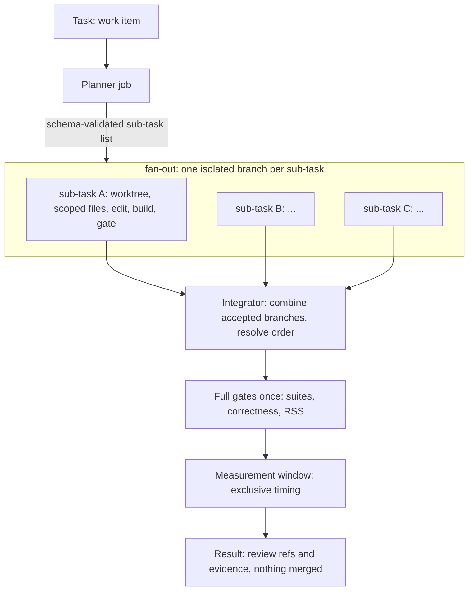

# Agent worker framework: a native toolbox for delegated, parallel, resource-aware work

Status: DESIGN, 2026-11-09. Intended to become its own project (working name `sub0work`, placeholder) with Sub0Llm as one
inference engine among several. Related: #68 (the existing optimisation harness), #77 (goal), #78 (machine test), the
Sub0Pipeline and Sub0Pub libraries. Legend: **[V]** verified in the repo or the library READMEs, **[P]** proposed,
**[U]** unknown until tested.

## 1. Requirements (from the owner)

1. Run work as a **separate background job** that can be delegated to, checked, followed, cancelled and resumed.
2. **Run workers in parallel**, and let one task be **split automatically into sub-tasks** (for example one per function or
   per format to implement), then recombined.
3. Use the existing **sub-pipeline (DAG) tooling and Sub0Pub for messaging**.
4. A **native application**: performant, **without redundancy** (no second scheduler, no second message bus).
5. **Share resources** and schedule **collaboratively** (cores, memory, a model server, build caches, the exclusive
   measurement window).
6. A start of an agentic worker framework that can be **split into a toolbox project** later, with Sub0Llm as an engine.
   **Several engines and runtimes** are supported side by side: llama.cpp and our native Sub0Llm directly (section 8).
7. The LLM engine must support **multiple concurrent users**, and the scheduler must **know the engine's concurrency cap**
   (section 5a).

## 2. What exists and must be reused [V]

| Piece | What it gives | Limits stated by its own docs |
|---|---|---|
| **Sub0Pipeline** (public, C++23) | DAG of jobs with explicit dependencies, fan-out/fan-in, runtime-sized graphs; pluggable executors (inline, thread-per-job, priority pool); per-job names, timeouts, priority, core affinity hints; cancellation tokens; `RunScope` structured teardown; **deferred completion** (a job completes when a handle is signalled from any thread and holds no executor thread while waiting); **remote sub-graphs** (a sub-graph of registered job kinds runs in a worker process behind an `ITransport`, one deferred job on the coordinator; pipe and in-memory loopback transports shipped); `Payload` (inline up to 64 KiB, or a handle up to 64 bytes such as a content hash resolved through an `IPayloadStore`; larger payloads use streaming or shared memory); observer events and Chrome-Trace capture | no work stealing; **no cluster-wide scheduling or worker discovery**; no resource arbitration (hints only); socket transport is consumer-supplied |
| **Sub0Pub** (public, C++23) | typed publish/subscribe; a message type decides delivery (runtime broker, or direct calls when receivers are named); transport bridges (`Forward`, `Route`, split-horizon `publishFrom`); `StreamSerializer`/`StreamDeserializer` | **no queue, retries or delivery guarantees**; no network stack or pipe; the default binary format is the in-memory layout, not a portable schema |
| Existing harness (`scripts/optimization/*`) | resumable runs (`state.json`, `optimization-run-1`), a per-run `flock`, fresh detached worktrees per attempt, pinned identities and evidence hashes, process-group teardown of the inference server, `--resume`, bounded budgets, stall packets | single machine, single run at a time, Python, one hard-wired loop |
| `sub0perf` lock | the exclusive "quiet machine" window around inference and timing | advisory, per host, Python |
| Machine facts (this host) | decode cores 0-7, batch cores 0-15 pinned in `perf/optimization/llama-cpp.json`; 29.6 GiB RAM; a 7 GB model server per run | |

A first Python supervisor (submit/status/logs/cancel/wait over a detached process group) was prototyped and **discarded**:
it duplicated what Sub0Pipeline provides and would be a second implementation to retire. What it taught is kept here:
own process group per job so cancel can stop a worker and the server it spawned and verify nothing is left; derive "lost"
from a dead supervisor rather than trusting a stale "running"; distinguish cancelled from failed; keep runs resumable.

## 3. Architecture [P]

```mermaid
flowchart LR
    subgraph clients["Clients (CLI, agents, CI)"]
      CLI[sub0work submit | status | logs | cancel | wait | resume]
      AG[Agents: Claude Code, Codex, ...]
    end
    subgraph daemon["sub0workd (native, one per host)"]
      CO[Coordinator: Sub0Pipeline graphs and executors]
      AR[Resource arbiter: leases, queues, quiet windows]
      BUS[Sub0Pub event bus: typed events]
      JR[(Journal and snapshots)]
      PL[Planner jobs: split a task into a sub-task graph]
      CO --- AR
      CO --- BUS
      BUS --> JR
      PL --> CO
    end
    subgraph workers["Workers (processes, Sub0Pipeline remote sub-graphs)"]
      W1[Worktree builder / editor]
      W2[Evaluator: correctness, RSS, timing]
      W3[Measurement worker: exclusive window]
      W4[Inference client]
    end
    subgraph engines["Inference engines (shared, leased)"]
      E1[llama.cpp server]
      E2[Sub0Llm engine]
    end
    CLI <-->|local socket| daemon
    AG <-->|same API| daemon
    CO <-->|ITransport| workers
    W4 --> E1
    W4 --> E2
```

- **One native daemon per host** (`sub0workd`) hosts a Sub0Pipeline coordinator, the resource arbiter, an event bus and the
  journal. A thin CLI and any agent talk to it over a local socket (named pipe on Windows); it never listens on a network.
- **Workers are processes** hosting registered job kinds (`WorkerHost`), reached through Sub0Pipeline's remote sub-graph
  mechanism. A worker per git worktree isolates edits; an evaluator worker owns builds and checks; a measurement worker
  holds the exclusive window.
- **Engines are leased, shared services**, not owned by one job (section 7).
- **No redundancy rule:** scheduling = Sub0Pipeline, in-process messaging = Sub0Pub, resource admission = the one new
  component (the arbiter), durability = the one new journal. Anything that duplicates one of these is rejected in review.

## 4. Job model and lifecycle [P]

A **job** is a Sub0Pipeline graph (often a single remote sub-graph) plus metadata. States: `queued`, `running`,
`succeeded`, `failed`, `cancelled`, `lost` (supervisor gone without a record), `paused-for-measurement` (section 5).
Each job has an id, owner, pinned input identities (source commit, tool and model hashes, as the harness already
pins them), a resource request, a budget (attempts, wall time, tokens) and an evidence directory.

- **Cancel** is cooperative first (stop token reaches the job through Sub0Pipeline), then escalates to the worker's process
  group, and succeeds only when the arbiter confirms all leases released and no child (including a model server) remains.
  State becomes `cancelled`, never `failed`; the run stays resumable.
- **Resume** requires the same job identity and a non-terminal or cancelled record; interrupted attempts stay recorded
  (the harness's existing rule).
- **Idempotence**: job kinds declare whether re-running is safe; external writes (push, merge, PR) are never automatic
  (the harness's existing "preserve for review, do not promote" rule is a framework invariant).
- **Progress** is a typed event stream plus a snapshot, so a client can ask "what is it doing" without reading logs.

## 5. Resources and collaborative scheduling [P]

Neither Sub0Pipeline (hints only) nor Sub0Pub provides admission control, so the **arbiter** is the new core component.

| Resource | Kind | Notes |
|---|---|---|
| CPU cores (sets) | partitionable | e.g. decode 0-7 and batch 0-15 for inference, build cores for compilers; leases are sets, not counts |
| Memory (MiB) | budgeted | admission refuses a job that would exceed the host budget (29.6 GiB visible here; a model server is about 7 GB, a corpus run about 6 GiB) |
| Model server slot | shared, counted | one warm server serves many jobs; leases are slots, not processes |
| Measurement window | exclusive | the quiet machine needed for timing and for inference-versus-timing separation; the `sub0perf` lock semantics |
| Worktree / build-cache slot | pooled | shared cache dirs (ccache, build trees) reused across sub-tasks; worktrees leased and recycled |

Rules:
1. A job's graph begins with a **deferred acquire job** (completes when the arbiter grants the lease, holding no thread
   while queued) and ends with a release; the lease is scoped to the job so a crash or cancel always releases.
2. **Gang admission**: a job gets all its resources or none (no hold-and-wait deadlocks); leases are taken in a global order.
3. **Priorities and fairness** use Sub0Pipeline's priority hint plus per-owner shares; starvation is reported, not hidden.
4. **Collaborative, not just exclusive**: a long job registers a *yield point* and a *checkpoint*; when a measurement
   window is requested, the arbiter signals running jobs, they reach a yield point, release CPU leases and resume after.
   Non-cooperating jobs are never frozen silently; they either finish first or the window waits (configurable), because a
   frozen job can invalidate its own timing.
5. **Warm sharing**: engines and caches stay alive between jobs under reference-counted leases with an idle timeout.
6. The arbiter publishes every grant, wait and release as events, so waiting time and contention are measurable.

## 5a. Engine concurrency and the cap [P]

Parallel workers all want the model. That only works if the **engine supports several concurrent users** and the scheduler
**knows how many**. Today the answer is one: the checked-in harness profile runs llama.cpp with **one slot at 4,096
context** [V: `perf/optimization/llama-cpu.json`], so sub-task proposals would serialise on the model while edits and builds run
in parallel. The framework must therefore treat engine concurrency as data, not an assumption.

**Capability handshake.** Every engine advertises, and may revise at run time, an `EngineCaps` record:
`maxConcurrentSequences` (slots), `contextPerSequence`, `maxBatchTokens`, `batching` (none, static, continuous),
`memoryPerSequenceMiB`, the **measured** aggregate prefill and decode tokens/s at 1..N concurrent sequences, queue policy
and health. The engine publishes `EngineCapsChanged` (for example when memory pressure lowers the cap) and the arbiter
follows it.

**Scheduler rules.**
1. Slots are the counted, shared resource of section 5: the scheduler **never admits more concurrent inference than the
   current cap**; excess requests queue with per-owner fairness and request deadlines (backpressure, not overload).
2. A job needing N parallel proposals asks for N slots as a gang, or is told the cap and degrades to sequential proposals.
3. The cap is learned, not configured: the machine test (#78) adds an engine-concurrency kernel (aggregate tokens/s and
   per-request latency versus N), and the arbiter's capacity is set from that measurement.
4. Prefill and decode of different jobs may share a step; measurement windows (section 5) still exclude everything else.

**What Sub0Llm needs to be such an engine (new work).** Concurrency is an engine feature, not a wrapper:
- per-sequence state (K/V cache plus recurrent GDN state) and a **batched decode step across sequences**: decode is bound by
  the work per weight, and N sequences share one weight stream per step, so aggregate throughput should rise with N until the
  compute roof (`PERFORMANCE_MODEL.md`). This is the same `project_batch` machinery #74 builds for prefill;
- continuous batching (sequences join and leave between steps), slot admission and an honest `EngineCaps`.

Memory per sequence for the 27B [D, from the model dimensions; the formulas are confirmed in the code]:
K/V = 16 full-attention layers x 1,024 (4 KV heads x 256) x 2 (K,V) x 4 B (F32) = 128 KiB per token, so 4,096 context is
512 MiB; GDN state = `gdn::state_floats` = heads x key-dim x value-dim = 48 x 128 x 128 floats per layer, x 48 layers x 4 B =
144 MiB (conv history extra). About **656 MiB per sequence at 4k context**, against about 5.4 GiB of mapped weights, so a
memory cap of roughly a dozen sequences on this host's budget; compute will probably bind first. Measure it (#78), do not
trust the arithmetic.

## 6. Decomposition: one task, many sub-tasks [P]



- **Planners** are job kinds: deterministic splitters (per function in a header, per file, per format variant, per
  checklist item; our own tickets #31-#41 are one sub-task per format) and model planners that emit a JSON sub-task list
  validated against a schema. A plan is data, recorded in the journal, never executed on trust.
- **Isolation**: each sub-task gets its own detached worktree from a common base, an editable-file allowlist and its own
  budget (the harness's contract). The planner must declare disjoint editable sets; overlap is serialised or rejected,
  so integration conflicts are designed out.
- **Parallel limits come from the arbiter**: edits and builds run in parallel up to the CPU and memory budget; model
  proposals share the leased inference slots; **timing never overlaps anything** (the measurement window).
- **Integrator** applies accepted sub-task branches in a deterministic order onto the base, re-runs the full gates once
  (a per-sub-task pass does not prove the combination), and reports; it never pushes or merges.
- **Graph growth**: Sub0Pipeline supports runtime-sized graphs and on-demand jobs, but whether jobs can be added to a graph
  mid-run is **[U]**; the safe design is staged pipelines (plan stage output builds the next pipeline) and is what the first
  milestone uses.

## 7. Messaging and durability [P]

- **In process: Sub0Pub.** Typed events with static wiring where the receivers are known: `JobQueued`, `JobStateChanged`,
  `AttemptFinished`, `LeaseGranted`, `LeaseWaiting`, `LeaseReleased`, `Progress`, `LogLine`, `MeasurementWindowRequested`.
- **Across processes:** the daemon and workers are built together, so Sub0Pub's `StreamSerializer` over the Sub0Pipeline
  transport is acceptable for the live bus **[U: verify layout compatibility checks at connect, as `makeLayout` allows]**.
- **Durability is separate.** Sub0Pub states it provides no queue or delivery guarantees, so the **journal** (append-only,
  versioned, stable schema, snapshot plus replay) is the source of truth for job state, evidence pointers and resume.
  The live bus is a view of the journal, not a second record.
- **Observability** reuses Sub0Pipeline's observer and Chrome-Trace capture for run timelines; status and tooling read the
  journal and the event stream.

## 8. Engines and runtimes: llama.cpp and native Sub0Llm, side by side [P]

The framework supports **several engines and several ways of running each**; no job names an engine, it states what it
needs and the scheduler picks one that can serve it.

| Runtime kind | How it is reached | Examples | Notes |
|---|---|---|---|
| External server | HTTP or stdio to a separately started process | llama.cpp `llama-server` (today) | isolation, easy teardown; the harness's current path |
| Spawned process | the framework starts and owns a child, speaks a framed protocol | `sub0llm` engine binary | same contract as above without a network server |
| **In-process library** | linked into a worker host; calls are function calls | **native Sub0Llm directly**, and `libllama` where wanted | no copy or IPC, mapped weights shared through the page cache across workers, cores and memory accounted by the arbiter |

**One engine seam** for all three (`IEngine`): `capabilities()`, `open(session)`, `generate(request, stream)`,
`cancel`, `close`, plus the capability events of section 5a. The request/response schema is the existing
`optimization-request-1` / `optimization-inference-1` contract (prompt-budget check before generation, schema-constrained
output, token rates, usage, peak RSS, teardown guarantee), so adapters for llama.cpp and Sub0Llm are interchangeable and a
work item can be replayed against both.

**Capabilities decide routing, and refusal is the default.** `EngineCaps` (section 5a) also lists what the engine can do:
maximum context per sequence, **structured or grammar-constrained output**, supported model formats and quant tiers,
sampling controls, streaming, batching mode and measured throughput. A request that exceeds an engine's capabilities is
refused with a reason, never truncated or silently degraded. This matters today: the Sub0Llm chat proving ground is a mapped
128-position backend and has no schema-constrained output, so it cannot serve the harness work items yet [V: harness doc];
llama.cpp can. Routing policy is explicit and recorded: pinned engine (a work item may require one), cheapest capable,
fastest capable, or matched A/B (the same item to both engines under the same seed and budget to compare latency, proposal
quality and cost per accepted candidate).

**Engines are leased services** (section 5): the arbiter owns their slots, cores and memory; a warm instance is shared by
many jobs under reference counts and an idle timeout; an in-process Sub0Llm engine is one more lease holder inside the
worker host that loaded it. Failure handling is uniform: an engine that dies or breaches its RSS limit fails its leases,
and the job's retry policy decides, so a llama.cpp outage can fall back to Sub0Llm for items it is capable of serving, and
the reverse.

Sub0Llm is also a **consumer**: its own kernel-optimisation, qualification and measurement loops (#63, #68, #78) run as job
kinds, so it uses the toolbox instead of growing a copy. Bringing Sub0Llm up as an engine needs the concurrency work in
section 5a (#90), structured-output support, and context beyond the proving ground's 128 positions.

## 9. Native, and what that buys [P]

Jobs are coarse (minutes), so raw throughput is not the point. Native is chosen for: a **single static binary** with no
Python runtime to version; **deterministic accounting** of cores, memory and processes (affinity, cgroup or process-group
control, exact teardown); **reuse of the Sub0 family libraries** instead of re-implementing them; embeddability in
Sub0Llm tools; and a near-zero idle cost. Budgets to test, not assume: submit/status round trip in milliseconds, daemon idle
CPU effectively zero, journal append without per-event fsync storms.

## 10. Migration and extraction

| Milestone | Deliverable | Gate |
|---|---|---|
| M0 | this design agreed; name, repo and licence decided; Sub0Pipeline/Sub0Pub versions pinned | owner sign-off |
| M1 | `sub0workd` + CLI running the **existing Python harness unchanged as an external job kind** (process job): submit, status, logs, cancel (tree teardown verified, no stray server), wait, resume | cancel leaves no child; `lost` detected; resume works on a real `state.json` |
| M2 | arbiter: core sets, memory budget, exclusive measurement lease, scoped release; journal and replay | two jobs cannot overlap the window; crash releases leases |
| M3 | Sub0Pub event stream, progress snapshots, Chrome-Trace timeline | status without parsing logs |
| M4 | planner and fan-out/fan-in: first splitter = one sub-task per quant format (#34-#41) with disjoint files | integrator re-runs gates once; no overlapping edits |
| M5 | `IEngine` seam with `EngineCaps`, capability-based routing and slot leasing: llama.cpp server (slots > 1) first, then native Sub0Llm as a spawned process and as an in-process library with concurrent sequences | scheduler never exceeds the advertised cap; an over-capability request is refused with a reason; the same item runs on both engines with comparable evidence |
| M6 | split into the toolbox repo; Sub0Llm consumes it as a dependency | Sub0Llm builds and runs its loops from the toolbox |

Port Python pieces to native only when stable and hot (the evaluator and arbiter first); never maintain both.

## 11. Open questions [U]

- Can Sub0Pipeline add jobs to a running graph? (Test before M4; staged pipelines are the fallback.)
- Socket transport for `ITransport` (consumer-supplied; `FrameReader` handles framing) and the Windows equivalent; the previous
  dev machine was Windows.
- Whether CPU yield uses cooperative checkpoints only or also cgroup freezing where available (a user systemd session exists
  here; lingering is off, so units end at logout).
- Layout/ABI compatibility policy for Sub0Pub over a transport between independently built peers.
- Name, repository, licence and ownership of the arbiter and journal formats.
- How sub-task disjointness is verified when a model planner proposes the split.

## 12. Tickets to raise

Framework design sign-off and naming (M0); daemon + CLI wrapping the existing harness (M1); arbiter and journal (M2);
event stream and timeline (M3); planner/fan-out (M4); engine seam and shared server (M5); extraction (M6). Related existing
work: #68 (harness), #78 (machine test, supplies the host facts the arbiter needs), #79 (kernel inventory).
