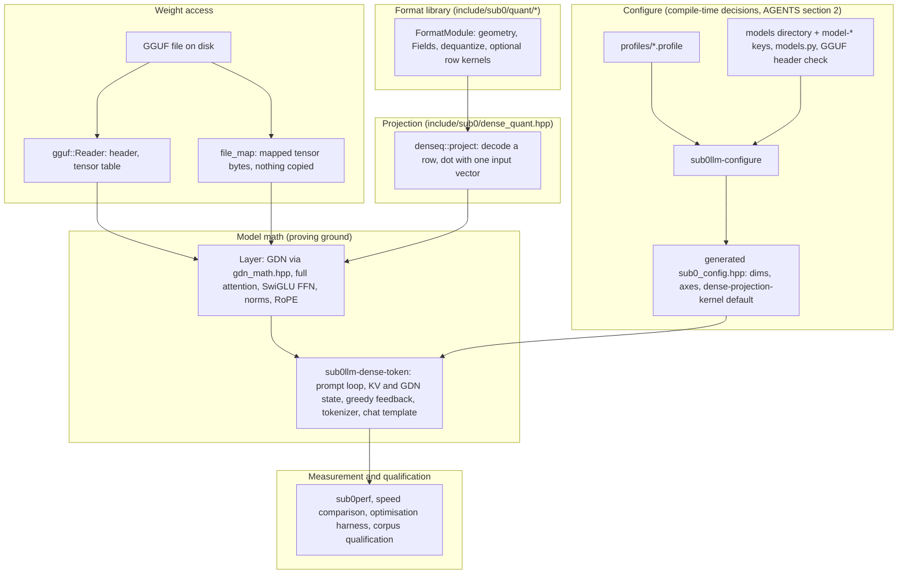
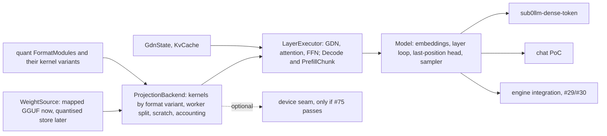

# Architecture: how the pieces fit, and the seams to keep them modular

Status: DESIGN. Describes the dense Qwen path as it is today and the seams that let parts be iterated independently.
Tracking: #27, #28, #29, #30 (engine path), #18 (format modules), #74 (batching), #75 (device), #78 (measurement).
Legend: **[V]** verified in the repo, **[P]** proposed.

## 1. The layers today [V]

Facts behind the diagram:
- Profiles are files; the configurator reads them and bakes dims and the default projection kernel into the generated
  header (`--dense-projection-kernel auto|baseline|scalar|native|native-all`) [V].
- `gguf.hpp` composes its format tables from the nine legacy entries plus `quant::kModules` [V], so a new module enters
  size rules, dispatch and the registry tests with no other edit.
- `denseq::project` decodes each row block by block and dots it with ONE float vector; `Layer::project_impl` splits the
  output rows over at most 8 OpenMP workers [V].
- `sub0llm-dense-token` is the whole decoder in one translation unit plus `tools/dense_qwen_support.hpp`: embedding,
  64 layers, full-attention math inline, FFN, final norm and Q3_K LM head, persistent GDN state and F32 K/V, greedy
  continuation, embedded tokenizer and chat template. The chat proving ground sits on it (`docs/QWEN_CHAT_POC.md`) [V].
- **The general engine does not load these mapped tensors** (`docs/QWEN27B_NATIVE_TOKEN.md`: "a standalone proving
  ground; the general engine loader does not yet load these mapped tensor views") [V]. #27/#28/#29 are about closing that.

## 2. Where it is hard to iterate (the seams to cut) [P]

| # | Today | Problem | Proposed seam |
|---|---|---|---|
| 1 | Kernel choice is an IQ1-named enum plus a string (`Iq1Kernel`, `fused-iq2`) | adding a kernel edits shared code; no per-format default | per-format named variants declared by the module, one selector (`QUANT_LIBRARY.md` section 4.1) |
| 2 | Projection lives in `Layer` (threading, scratch, profiling, row permutation callbacks) | cannot be reused by batching or the engine | a `ProjectionBackend`: `project`, `project_batch`, owns worker split, scratch and accounting; `Layer` only supplies tensors and permutations |
| 3 | Decoder is a monolithic `main` + one support header | prefill, decode, chat and tests duplicate or bypass it | extract a model library: `LayerExecutor` (GDN, attention, FFN) with `Decode` and `PrefillChunk` modes, state objects (`GdnState`, `KvCache`) and a `Model` that the tool, chat PoC and later the engine call |
| 4 | Weights are read via `reader.tensor_bytes(t)` inline | a quantised-resident store (#28) or another file type would touch every call site | a `WeightSource` returning `(role, layer) -> {type, bytes, dims}`; mapped GGUF is the first implementation |
| 5 | GDN native path is `T == 1` only, callback takes one vector | blocks batched prefill (#74) | optional `project_batch` callback, other callers unchanged (`PREFILL_BATCHING.md` section 3) |
| 6 | Measurement kernels scattered; results not tied to a machine | cannot say what limits a result | `MEASUREMENT_PLATFORM.md` |
| 7 | Device backends are CUDA-shaped plus Intel groundwork | no AMD path | keep the neutral C seam `include/sub0/device_backend.hpp` (link-time choice, `sub0_dev_*`); decide by experiment before writing any backend (#75) |

Dependency rules to enforce while cutting seams (a header may only include downward):
`quant/*` depends on `format.hpp` and the table headers only; `dense_quant.hpp` on `gguf.hpp` and `quant`;
`ProjectionBackend` on `dense_quant`; `LayerExecutor` on `ProjectionBackend`, `gdn_math`, `layout`; tools on everything;
tests exist at each layer. No upward includes, no tool-only types in `include/sub0`.

## 3. Target shape [P]

Rules that keep this cheap:
1. **Do not rewrite to get there.** Each seam is cut as part of a ticket that needs it (the batched hook in #74 forces seam
   2 and 5; the kernel selector comes with the next format kernel; the `WeightSource` with #27/#28). Behaviour is proven
   unchanged by byte-identical per-position dumps on the fixed workload before and after each cut (the PR #76 check).
2. **Defaults stay baked and off until proven** (AGENTS sections 2 and 4); a new capability is a configurator axis, not a runtime knob.
3. **Every seam has a test at its level** and a fixture from real data; a ticket that adds a seam lists them.

## 4. What this means for the open tickets

| Ticket | Seam it exercises |
|---|---|
| #74 batched prefill | 2 (`project_batch`), 5 (GDN hook), 3 (chunk mode) |
| #31-#41 format kernels | 1 (selector), formats library |
| #63/#66/#70 qualification | selector defaults, generated profile |
| #27 / #28 | 4 (`WeightSource`), store keyed (role, layer) |
| #29 / #30 | 3 (shared model library), parity gate |
| #75 device | 7, only after the experiment |
| #78 / #79 / #80 | measurement platform |
