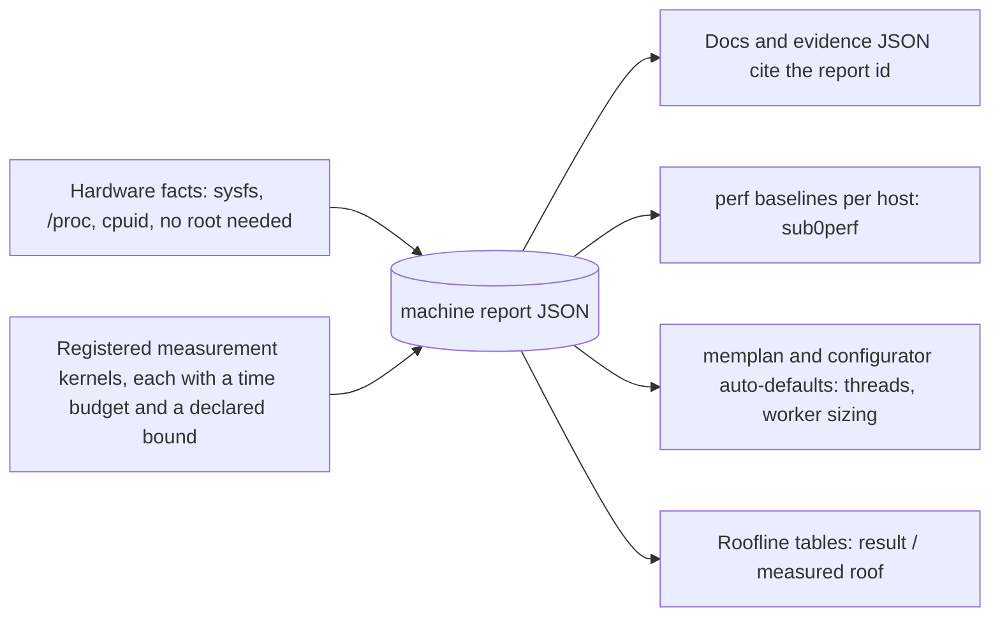

# Measurement platform: `sub0llm machine`, provenance, the kernel registry

Status: DESIGN. Tracking: #78 (machine test), #79 (inventory and migration), #80 (provenance), #81 (kernel tracking),
#75 (GPU decision experiment). Legend: **[V]** verified in the repo, **[P]** proposed, **[U]** unknown.

## 1. What already exists and must be reused [V]

| Piece | What it gives | Where |
|---|---|---|
| `sub0perf` (vendored from Sub0Math, pinned commit in `UPSTREAM.json`) | interleaved rounds in fresh processes, a calibration kernel that corrects for clock drift, load-aware settling, per-host baselines, accept/gate for pre-push, `--soak` sustained-speed calibration | `tools/perf/bench_check.py`, `tools/perf/sub0perf/*`, `tools/perf/bench_runner.hpp` |
| Benchmark CLI contract (nanobench) | `--filter --exact --epochs --json --soak --list --calibration` shared by every benchmark executable | `tools/perf/bench_runner.hpp` |
| Per-host baselines | `perf/baselines/crogbuntu1.json` and its README | `perf/baselines/` |
| Host roof probes | eight pinned cores: FP32 1,386.89 GFLOP/s, INT8 5,546.30 GOP/s, 32.894 GB/s sequential read (1 GiB buffer, median of 3) | `tools/reference/bench_host_roofs.cpp`, results in `docs/performance/QWEN27B_SPEED_COMPARISON.md` |
| End-to-end speed comparison | rotated rounds, taint rules, hashes of sources/binaries/model before and after, llama.cpp as comparator | `scripts/compare_qwen_speed.py`, `tools/reference/bench_llama_phases.cpp` |
| Focused optimisation loop | work-item JSON, isolated candidate checkouts, paired timing, correctness and RSS gates | `scripts/optimization/*`, `perf/optimization/*`, `docs/performance/QWEN_OPTIMIZATION_HARNESS.md` |
| Quality qualification | frozen 4,096-target corpus, independent reference, resumable capture, strict judge | `scripts/qwen_quality.py`, `perf/quality/qwen27b-v1/` |
| Kernel microbenchmarks | dequant, quant dot, IQ1_S, float reduction, MoE expert, Muon, frontend | `benchmarks/*.cpp`, `benchmarks/*.hpp`, `tools/sub0llm-bench-*.cpp` |

## 2. Gaps

- No record of what the machine IS. The recorded comparison says "64 GB RAM" while the OS shows 29.6 GiB with a
  1.00 GiB iGPU carve-out (`/proc/meminfo`, sysfs `mem_info_vram_total`); older docs describe a different Intel box (#80).
- The roofs come from one probe hard-wired to 8 threads, one buffer size and one ISA path. Unknown: 16/32-thread
  bandwidth, theoretical DRAM bandwidth (DIMM speed unreadable without root), cache-level bandwidth, latency,
  cold-versus-warm model-load bandwidth, scaling beyond one CCD.
- Nothing links a published number to the machine that made it.
- Measurement kernels are spread over `benchmarks/`, `tools/`, `scripts/` and docs with no common listing.

## 3. Design: one tool, a kernel registry, a JSON report [P]



**Command.** `sub0llm-machine` (and a `sub0llm machine` subcommand) prints a human summary and writes
`out/machine/<host>-<date>.json` with `schema: sub0llm-machine-1`; `sub0llm-machine compare A.json B.json` diffs two
reports. Modes: `--quick` (default, hard wall-clock budget of about 15 s in total), `--full` (budgets of minutes, for
tuning), `--list`, `--filter`.

**Facts (no kernels, no root).** CPU model, sockets/cores/threads and physical-core topology (CCD/CCX or P/E), ISA flags
that matter (AVX2, FMA, AVX-512, VNNI, AVX-VNNI-INT8), per-level cache sizes, OS-visible and installed memory with the
carve-out shown separately, swap, NUMA, kernel version and governor (#81), THP, scaling frequency, compiler and flags,
GPU/iGPU with VRAM/GTT split, the storage device and filesystem under the model directory. Anything not readable
without root (DIMM speed, channels) is reported as `unknown`, or taken from an explicit `--dram-spec`, and **never
guessed**. A stable `machine_id` is a hash of the facts that define comparability (CPU model, topology, installed
memory if known else visible memory, kernel major, compiler).

**Kernel interface (sketch).**

```cpp
struct MeasurementKernel {
    std::string_view name;          // "mem.read.seq", "fma.f32.avx512", "load.cold.gguf", ...
    std::string_view unit;          // "GB/s", "GFLOP/s", "ns", "GOP/s"
    Budget budget;                  // quick/full wall-clock caps
    std::optional<Bound> bound;     // theoretical bound with its inputs, or none
    bool (*available)();            // skipped with a stated reason when false (no GPU, no AVX-512)
    Sample (*run)(Ctx&);            // setup done outside the timed region; no allocation inside it
};
```

Rules: every kernel self-limits by time and adaptive repetitions; reports min, median and CV; flags a noisy run
(background CPU, clock drift via the existing calibration kernel) instead of retrying forever; uses fixed seeds and
buffers; allocates before the timed region only (AGENTS section 1). A registry list header plus a generic test
(finishes within budget, finite values, schema-valid, skipped-with-reason when unavailable) means a new kernel is one
module and one line, the same pattern as the quant format registry (`QUANT_LIBRARY.md`).

**Reuse, do not rebuild.** Kernels are written in the `bench_runner.hpp` (nanobench) shape so `bench_check.py`'s
interleaving, calibration and per-host baselines apply to them unchanged; the machine driver is a thin, budgeted
front end over the same kernels. `bench_host_roofs.cpp` becomes the first migrated kernel set.

**Initial kernel set.**

| Group | Kernels | Declared bound |
|---|---|---|
| Memory | read, write, copy, triad at 1, 2, 4, 8, 16, 32 threads; working-set sweep L1 to DRAM; random-access latency | channels x MT/s x 8 B when known, else none |
| Compute | FMA FP32 per core and all cores (AVX2 and AVX-512 paths); INT8 dot (VNNI where present); thread scaling incl. SMT; OpenMP fork/barrier cost | cores x lanes x FMA ports x clock |
| Loading | warm page-cache and cold-file mmap read bandwidth over a model-sized file; first-touch cost | device spec when known |
| Format kernels | GB/s of encoded weight consumed by each registered quant kernel per tier (`QUANT_LIBRARY.md`) | fraction of the measured memory bandwidth |
| Platform | timer resolution, clock stability during the run, background load | none |
| Device (optional) | iGPU: GTT buffer read GB/s, FP32 and int8-dot throughput, each with the CPU idle then streaming (`#75`) | none |

**Time budget by design.** Quick mode is a fixed budget split over the kernels by priority (memory and FMA first,
format kernels next, device and loading last), each kernel capped; a kernel that cannot finish its share reports
what it has with a `truncated` flag. The suite never loops on noise.

## 4. Provenance (#80) [P]

Rule: every recorded measurement carries `machine_id` and a pointer to its report. A number without one is labelled
"historical, machine unknown". Old numbers are labelled, never rewritten.
1. Update `docs/WORKING_PRACTICES.md` section 7 and the HANDOVER dev-machine facts to the AMD box; keep the Intel facts
   as a dated "previous machine" section.
2. Add a machine header to `docs/performance/*` documents after checking their evidence JSON host fields.
3. Make `run_perf_suite.py`, `compare_qwen_speed.py`, the optimisation harness and the quality capture embed the id
   (extend the evidence JSON they already write).
4. Resolve the memory discrepancy: the 29.6 GiB visible fits 32 GB installed minus the iGPU carve-out; installed size is
   unconfirmed until read with root or `--dram-spec`.

## 5. Inventory and migration (#79)

For each existing kernel record: what it measures, unit, micro-kernel (migrate into the registry) or end-to-end workload
(keep as a workflow, link from the report), and the machine its recorded results came from. Sources to read:
`benchmarks/*` (`backbone_dequant_bench`, `backbone_quant_dot_bench`, `dense_quant_perf`, `float_reduce_perf`,
`iq1s_perf`, `moe_expert_bench`, `muon_bench`, `frontend_bench`), `tools/sub0llm-bench-gemv.cpp`,
`tools/sub0llm-bench-moeqd.cpp`, `tools/sub0llm-dense-probe.cpp`, `tools/sub0llm-model-probe.cpp`, `tools/perf*`,
`tools/intel_probe`, `scripts/perf_sandbox.py`, `scripts/page_cache.py`, the roof probes in the speed comparison, and the
bandwidth discussions in `docs/CPU_PERF_BACKLOG.md`, `docs/BACKBONE_PRECISION.md`, `docs/STORAGE_STACK_PLAN.md` and the Intel iGPU
documents. Several recorded figures (for example 79 GB/s) describe the old Intel host and are historical.

## 6. Kernel and OS tracking (#81) [P]

The report records kernel version, governor, THP, readahead and `ttm.pages_limit`/GTT size, so any result is tied to them.
A research pass reported kernels 7.1 to 7.3 as released and 7.4 in development; nothing found specific to APU unified
memory or `amd-pstate`. These are leads to measure before and after an upgrade (cold/warm load kernel, scheduling
effects), not claims. Upgrading is the owner's decision.

## 7. GPU decision experiment (#75) [P]

The iGPU is the 2-CU Raphael RDNA2 part (sysfs: 1.00 GiB VRAM carve-out, 14.78 GiB GTT; clock table 400/600/2200 MHz),
sharing the CPU's DRAM. Peak FP32 is about 0.56 TFLOPS against a measured 1.39 TFLOPS for eight CPU cores [D]. The
experiment is a standalone Vulkan microbenchmark inside the machine test: GTT streaming GB/s, FP32 and int8-dot
throughput, each with the CPU idle and then under a 16-thread memory load. Park the #75 backend (kept and toggleable,
AGENTS section 13) if the iGPU gets under about 15-20% of the CPU's bandwidth and under about half its int8 compute;
otherwise design the device seam work in `docs/BACKENDS.md` terms. No backend code before that result.

## 8. Test plan

Registry test (budget, finiteness, skip reasons, schema); a quick run completes inside its budget on this machine;
DRAM bandwidth reproducible across three fresh processes within a stated CV; the report is valid with no root;
`compare` flags a differing `machine_id`; a golden JSON schema file under `tests/`.
