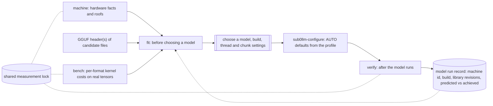

# Measure, select, verify: a first-class family around the model lifecycle

Status: DESIGN, 2026-11-09. Refines `MEASUREMENT_PLATFORM.md` (section 3, where the machine test lives) after the question "should this
tooling be inside Sub0Llm's first-class feature set, and what else belongs with it?". Tracking: #78 (machine test), #79, #80, #81,
plus the tickets listed at the end. Legend: **[V]** verified in the repo, **[P]** proposed, **[U]** unknown.

## 1. Decision: yes, first-class in Sub0Llm

The tooling answers one question, **"what can this engine do on this machine with this model?"**, and every part of that
depends on engine internals that only Sub0Llm has: the GGUF reader and format modules, the kernel tiers, `memplan`, the per-sequence
state sizes. It also feeds Sub0Llm's own defaults (`sub0llm-configure` resolves AUTO defaults in one place; measured values should
replace guesses). The engine already treats this as first-class: the `sub0llm` driver dispatches `tune`, `bench`, `report` and
`memplan` (`src/driver.cpp`) [V]. What is missing is the machine profile, the pre-selection step, the post-run record, and a shared
way to keep sessions from disturbing each other's measurements.

Boundary with the agent framework (Sub0Squad): **Sub0Llm owns what the engine can do here; Sub0Squad owns who may use the machine
when.** Sub0Squad consumes the machine profile and `EngineCaps` as JSON and never learns engine internals. The lock protocol
(section 4) is shared infrastructure, not owned by either.

## 2. The family: machine, fit, bench, verify



| Command | When | Needs engine config? | What it does |
|---|---|---|---|
| `sub0llm-machine` | once per machine, and after OS/kernel/BIOS changes | no (stage-1 like `sub0llm-configure`) | hardware facts (no root needed) plus time-budgeted roofs: memory read/write/copy at 1..32 threads, FP32 and INT8 compute, cache sweep, latency, warm/cold load. JSON `sub0llm-machine-1` with a stable machine id. Design: `MEASUREMENT_PLATFORM.md` |
| `sub0llm-fit` (**pre-selection**) | before downloading or choosing a model | no (reads GGUF headers and the machine profile) | for one or several candidate files (for example the quant tiers of one model): does it fit (mapped weights, per-sequence K/V and recurrent state at the chosen context, workspace, against the memory budget and the RSS gate); predicted decode bound (bytes per token divided by measured bandwidth for the thread count) and prefill bound (FLOPs per token over measured FP32 and INT8 compute); kernel coverage per tensor type (tier T0 to T3) with the predicted cost of formats that only have a slow path; estimated engine concurrency cap (`EngineCaps`, #90); a ranked table with warnings. Every number is labelled predicted and carries the inputs it came from |
| `sub0llm bench` / `sub0llm-bench` (**micro**) | development, tuning, after kernel changes | no | named suites in the existing `bench_runner` (nanobench) shape so `sub0perf` interleaving, calibration and per-host baselines apply: `machine` (the roofs), `formats` (every format kernel on real tensors from a chosen model; the prefill prover becomes `bench formats --batch`), `projection`, and the existing `benchmarks/*` kernels. Results are keyed by machine id |
| `sub0llm verify` (**post-selection**) | after a model is chosen and built | yes (a built engine, or the proving-ground decoder `sub0llm-dense-token` until the engine loads the mapped model) | runs the standard gates on the real model: logit gate against the recorded reference, peak RSS against the prediction, achieved tokens/s against the predicted bounds (**achieved fraction**), measured concurrency cap. Writes a **model run record** beside the model: machine id, build id, library revisions, kernel variants selected, predicted versus achieved. It closes the loop: large prediction errors become bugs in `fit`, not silent surprises |

Rules:
1. **Predictions are never results.** `fit` states its inputs and error model; `verify` records the miss; the miss is tracked over time.
2. **Config-independent where possible.** `machine`, `fit` and `bench` must run on a fresh clone before any model is configured, so they can drive the configuration; only `verify` needs the built engine. Library code lives in one config-independent `sub0llm_measure` library; executables stay thin (no new tool per experiment: the prover is a mode of `bench`, not a permanent separate program).
3. **Existing stages are reconciled, not duplicated.** `memplan` (predicted footprints) becomes the memory half of `fit`; `tune` (writes `sub0_tune.cache`, read by the configurator) becomes a consumer of the machine profile; `report` (model sizing versus corpus) stays, with `verify` as its run-time counterpart.
4. **AUTO defaults come from the profile.** Thread counts, worker sizing, prefill chunk and context budget resolve in `resolve_decode_defaults`-style code from the profile when one exists, else the old values, so default builds stay byte-identical until a profile is supplied (AGENTS section 4).

## 3. Pre- and post-selection, concretely

**Pre-selection example [P].** Given the 27B tiers from the model repository (5.8 GiB IQ1_S up to 46.6 GiB BF16) and this machine's profile,
`fit` would report: which tiers fit in 29.6 GiB at 4k context with N concurrent sequences; the decode bound per tier
(for IQ1_S: 5.76 GB per token over the measured bandwidth, 5.7 tok/s at the 8-core 32.9 GB/s probe [D from recorded numbers]);
which formats in a tier have only a slow kernel (IQ1_M and Q3_K today) and what that costs; and a recommendation with the reasons.
Header parsing exists (`gguf::Reader`, and the profile-versus-GGUF check from #13).

**Post-selection example [P].** After building, `verify` reports "decode 1.50 tok/s = 26% of the predicted 5.7 tok/s bound; prefill 1.51
tok/s = 5.6% of the FP32 bound; peak RSS 5.57 GiB against 5.4 GiB predicted; first continuation identical to the reference" and stores it.
Those are the numbers `PERFORMANCE_MODEL.md` already derives by hand.

## 4. Session safety: the measurement lock

What exists [V]: `sub0perf`'s `PerfLock` (`tools/perf/sub0perf/lock.py`) takes one measuring run at a time by creating
`.git/sub0perf/lock` exclusively (`O_CREAT|O_EXCL`) with JSON `{pid, time, what}`; it waits (poll 2 s, default timeout 900 s), and a lock
whose process is gone, or that is older than 6 hours, is taken over. `perf_dir` resolves the **git common directory**, so all worktrees of
one repository share the lock (Sub0Llm and its `Sub0Llm-pr67`, `Sub0Llm-74` worktrees do). The Python harness, the corpus capture and the
pre-push gate all use it.

The gap [V, from the code and the checkout layout]: **it is per repository, not per machine.** Sub0Pipeline, Sub0Pub, Sub0Squad, Sub0Math and
the others each have their own lock directory, so a measurement in one repository does not wait for, or warn, a measurement in another.
On this one dev machine that is exactly the case that corrupts timings.

Design [P]:
1. **A machine-wide lock** in addition to the per-repository one, with the same file protocol (exclusive create, JSON `{pid, time, what, repo}`,
   same stale rules) at a per-user location that exists for every repository (candidates: `$XDG_RUNTIME_DIR/sub0perf/machine.lock` with a `~/.cache`
   fallback; **[U]** pick one and handle cleanup at logout). Acquisition order is fixed, machine lock first then repository lock, so two sessions
   cannot deadlock.
2. **A native C++ `PerfLock`** speaking the same protocol, so `sub0llm-machine`, `sub0llm-bench`, `sub0llm verify` and the Sub0Squad arbiter's measurement
   window hold the same lock the Python tools hold. One implementation upstream with the existing perf primitives (Sub0Math tooling, the repo
   that `sub0perf` is vendored from, per `docs/performance/QWEN_OPTIMIZATION_HARNESS.md`), consumed by both Sub0Llm and Sub0Squad: no second copy.
3. **Every measuring command takes the lock; predicting commands do not.** `fit` and the facts part of `machine` are pure reads. A measuring command that cannot
   get the lock waits with the holder's `what` and pid in the message, then times out; there is no `--no-lock` outside tests.
4. **Calibration and quiet-load checks stay** (the `bench_check.py` calibration kernel and `--max-load` settling); lock-wait time and load at start are recorded in
   the result so a contested run is visible, not silently trusted.
5. **Sub0Squad's measurement window is this lock**, not a second concept: the arbiter's "exclusive measurement" lease holds it; yield points let other jobs
   release CPU first (`AGENT_WORKER_FRAMEWORK.md` section 5).
6. Watch the pre-push gate: a docs-only push already waited behind a corpus capture. The gate's path-based levelling should keep docs-only pushes off the lock; a machine-wide lock
   raises the stakes, so test that.

## 5. Where the code goes [P]

```
include/sub0/measure/   machine.hpp (facts), roofs kernels, fit.hpp (predictions), run_record.hpp, kernel registry  (config-independent)
benchmarks/             existing micro-benchmarks, registered with the kernel registry
tools/                  sub0llm-machine.cpp, sub0llm-fit.cpp (thin mains); sub0llm bench/verify via the driver
shared (upstream)       PerfLock (C++), same file protocol as sub0perf
```

## 6. Order of work

1. Native `PerfLock` (protocol-compatible, tested against the Python implementation), then the machine-wide lock; adopt it in the Python tools by configuration, not rewrite.
2. `sub0llm-machine`: facts and roofs, migrating `tools/reference/bench_host_roofs.cpp`; first answers the 16-thread bandwidth question in `PERFORMANCE_MODEL.md`.
3. `bench formats` (absorbing the prefill prover from PR #93) with machine-id-keyed results.
4. `sub0llm-fit` from the machine profile, GGUF headers and the `bench formats` table; validate its predictions against the recorded decode and prefill numbers.
5. `sub0llm verify` and the run record; reconcile with `report` and `memplan`.
6. `sub0llm-configure` consumes the profile for AUTO defaults.

## 7. Open questions

- Acceptable prediction error before `fit` is allowed to rank models, and how misses are tracked.
- Lock location and logout cleanup; behaviour under containers or several users on one machine.
- Whether `fit` needs a kernel-availability table exported by each format module (a natural output of the kernel selector, #82).
- How to treat model architectures the engine cannot run (refuse with the reason, as engines do in `AGENT_WORKER_FRAMEWORK.md` section 8).
