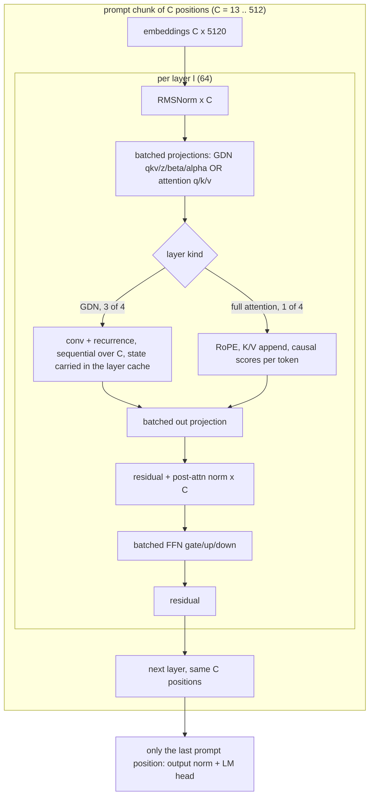

# Batched prefill (#74)

Status: DESIGN, not started. Prerequisites merged: #72/#73 (PR #76: hoisted per-layer state, intermediate LM-head
elision). Parents #29, #30; goal #77. Legend: **[V]** verified in the code or a record, **[P]** proposed, **[U]** unknown.

## 1. Problem and ceiling

Today every prompt token runs the full 64-layer forward alone, so the ~5.4 GiB of encoded weights are streamed once
per prompt token. llama.cpp evaluates the prompt in batches and reaches 17.0 prompt tok/s against Sub0Llm's 1.51 (best
draft, PR #67) [V]. The quoted "1.27" in #74 is the `native-all` kernel; the default `baseline` kernel measures
0.25 [V]. Always compare like with like and record the machine (#80).

From `PERFORMANCE_MODEL.md`: the FP32 compute roof of the eight-core probe is about 27 tok/s and the INT8 roof about
108 tok/s [D]. Batching removes the bandwidth term, so after it the result is set by kernel quality. This ticket aims to
make the weight stream a once-per-chunk cost and to reach a measured fraction of the compute roof, then hand the
remaining gap to the kernel tickets (T3 INT8 in `QUANT_LIBRARY.md`).

## 2. Why layer-major order is exact

For a prompt chunk of C positions, position t at layer l depends only on layer l-1's outputs at positions <= t and on
layer l's own recurrent state or K/V cache from positions < t. Running all C positions through layer l before
layer l+1 therefore computes the same values as token-major order; only the loop nest changes. Per-token arithmetic
stays identical if the batched kernels preserve each token's accumulation order, which is the design requirement
below. Decode (one token) stays token-major.

## 3. Components

1. **Batched projection** (`denseq::project_batch`, `QUANT_LIBRARY.md` section 4.3). For each output row: decode each
   quant block once, then dot it with all C input vectors. Per-token accumulators, same block and lane order as the
   serial kernel, so results are bit-identical per token to `denseq::project` [P]. Output layout `Y[token][row]`; the
   existing row-split OpenMP workers each own a row range for all tokens, so there are no write conflicts. Generic
   T1 version first, correct for every format; per-format `dot_rows_batch` for IQ1_S and IQ2_XXS next, in measured-cost order.
2. **FFN and attention in `sub0llm-dense-token`** (`tools/sub0llm-dense-token.cpp`, `tools/dense_qwen_support.hpp`). Today
   `Layer::project(t, x, in, y, out)` is single-vector; add `project_batch` with the same profile accounting. Attention
   scores/softmax stay per token (small next to the weight stream); K/V append happens for all C tokens before the
   per-token causal read, in position order.
3. **GDN native hook.** `gdn::forward(d, T, ...)` (`include/sub0/gdn_math.hpp`) already stages qkv/z/beta/alpha over T
   positions (scratch is T-sized) and runs conv and the recurrence sequentially, but trusts `native` only when `T == 1`
   and the callback `Native::Project` takes one vector [V]. Add an optional `Native::project_batch` callback used for
   T > 1 at the projection stages; the recurrence and conv history stay strictly sequential. Existing callers that set no
   hook keep the current behaviour byte for byte (AGENTS sections 4, 10: enumerate `gdn::forward` call sites first: engine
   `op_gdn`, `gdn_qwen4_fixture_tests`, the CUDA reference call).
4. **Scratch sizing.** All chunk buffers are allocated once per run (AGENTS section 1). For C = 512: FFN gate/up are
   512 x 17408 x 4 B = 35.6 MB each, hidden 10.5 MB, qkv 21 MB: well under the RSS gate. LM head runs for one position only.
5. **Chunking.** `--prefill-chunk N` (default off, serial path unchanged) so scaling can be measured at 13, 128 and 512
   tokens and the best default found. The configured context is 128 in the current generated profile (`seq = 128`), so the
   128/512-token measurements need a build with a larger `--seq` [V]; K/V cost at 1024 is about 134 MB (16 full-attention
   layers), negligible.
6. **Metrics.** Emit `batched_prefill: true` under `qwen-phase-1` [V: the schema and `phase_rates` accept one
   `prefill_ms` entry and `top_ids` of length 1 + decode steps for batched records, see `scripts/tests/test_qwen_speed.py`].
   For multi-chunk runs, aggregate chunk times into the single entry and put the per-chunk breakdown in an optional extra
   field, so the denominator rule (prompt tokens, not batches) and the existing script tests are untouched.

## 4. Gates and measurements

- Per token exactness: the batched run's per-position logits are **byte-identical** to the serial `native-all` run on the
  fixed 21-position workload (the same dump comparison used to verify PR #76, 1,386 files); where a kernel variant
  legitimately reassociates, the unchanged 16-position F32 logit gate (relative L2 <= 0.001) and an identical first
  continuation ID apply.
- `scripts/tests/test_qwen_speed.py` and `tools/reference/tests/check_phase_fixture.py` pass; CI tooling jobs green.
- Equivalence unit test: `project_batch` equals per-token `project` bit for bit for every format with real rows
  (`QUANT_LIBRARY.md` section 4.4).
- Scaling table: prompt tok/s at C = 1, 13, 128, 512 (and 1024 if context allows) with the roofline fraction and machine id.
- Sub0 and llama.cpp measured in the same interleaved rotation under the `sub0perf` controls (as `QWEN27B_SPEED_COMPARISON.md`).
- Default stays off until the corpus gate (#63) passes on the batched path; this change must not alter the default build.

## 5. Order of work

1. `project_batch` generic + equivalence tests (no tool change).
2. FFN and attention batching in `sub0llm-dense-token` behind `--prefill-chunk` (GDN layers still serial per token) and measure: this
   isolates how much of the model batches without touching `gdn::forward`.
3. GDN `project_batch` hook and its consumers audit.
4. Per-format batch kernels, IQ1_S and IQ2_XXS first.
5. Metrics and scripts, scaling table, then the three-pass iteration (AGENTS section 13).

## 6. Risks and unknowns

- **[U]** How much each stage gains: GDN layers are three quarters of the layers and run a sequential recurrence; the
  step-2 measurement tells whether the GDN hook is the critical path.
- The T1 batched kernel may be limited by the FMA loop (the code uses AVX2 intrinsics only [V]; a 512-bit variant is an
  open option), which is why the result is reported as a roofline fraction.
- INT8-activation batching is a separate design (T3); do not mix it into this change.
- Interaction with `--projection-threads` (max 8 [V]): batched work could use more cores; measure 16-core scaling in the
  machine test (#78) before raising that limit.
