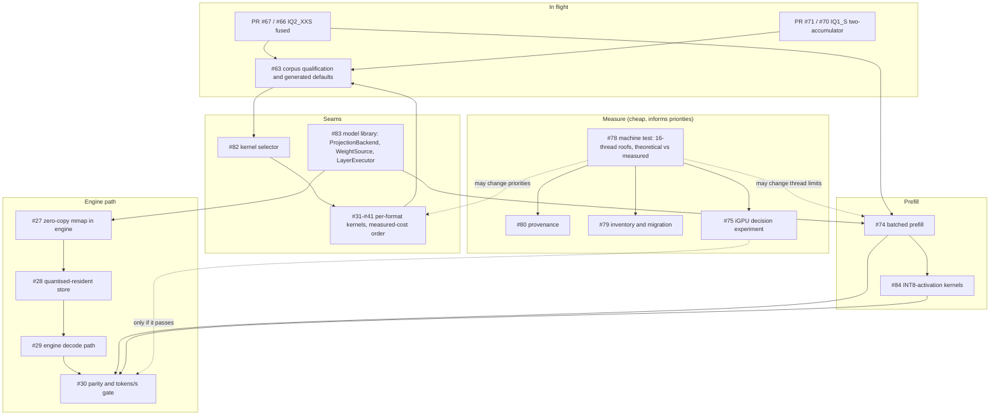

# Work plan: the 27B performance goal as dependent work packages

Status: PLAN, 2026-11-09. Goal: #77, match then exceed the pinned llama.cpp on the downloaded Qwen3.8-27B UD-IQ1_S on
this machine, at equal or better measured quality. Each package below has a ticket and a design section. Legend:
**[V]** verified, **[D]** derived from verified inputs, **[U]** unknown until a named measurement.

## 1. Where we are [V]

| Fact | Value |
|---|---|
| Sub0Llm `baseline` kernel (8 threads) | 0.25 prompt / 0.25 generated tok/s |
| `native-all` | 1.28 / 1.27 |
| draft PR #67 (fused IQ2_XXS) | 1.514 / 1.503 |
| clean llama.cpp | 17.03 / 4.27 |
| mapped weights, RSS | about 5.57 GiB at the 8 GiB gate |
| formats in the file | 10 quant types chosen per tensor; modules and dequantisers exist for all, fast kernels only for IQ1_S and IQ2_XXS |
| decode headroom to the 8-core bandwidth probe | llama.cpp at 74.8% of 5.71 tok/s; Sub0Llm at 26.3% [D] |
| prefill headroom | llama.cpp at 63% of the FP32 8-core roof (27.1 tok/s); Sub0Llm at 5.6% [D] |

Details and caveats: `PERFORMANCE_MODEL.md`.

## 2. Dependency map

## 3. Phases, order and gates

**Phase 0: finish what is staged (running).**
- PR #67: merged `main` into it, merged build verified byte-identical to the pre-merge candidate on all 1,386 dump files;
  the 4,096-target corpus capture on the merged binary is running (resumable, cached reference and baseline), then `judge`.
  Merge when the judge passes and the full engine/frontend suites match their recorded counts.
- PR #71: kernel-only today. After #67 lands: rebase, kernel gates, whole-model speed (expected only a few percent: IQ1_S
  is 28.6% of the profile and the kernel gain is 13.6%), then the same corpus capture (candidate windows only).
- Gate: unchanged 0.001 logit gate, 4,096-target judge, RSS gate, chat reset/overflow/EOS checks, no default promoted before #63.

**Phase 1: measure while kernels are in review (small, informative).**
- #78 first slice: facts report plus memory and FMA kernels at 1..32 threads, run with the CPU otherwise idle. It settles the
  two numbers that decide the endgame: 16-thread bandwidth and compute, and whether "exceed llama.cpp on decode" has
  headroom beyond the +34% the 8-core probe leaves [U]. #80 provenance edits are docs-only and can land in parallel.
- Gate: reproducible within a stated CV across three fresh processes; quick run inside its budget; valid without root.

**Phase 2: prefill (#74) with seams, in this order.** See `PREFILL_BATCHING.md` section 5: `project_batch` generic and
bit-equivalence tests, then FFN+attention batching in `sub0llm-dense-token` behind `--prefill-chunk`, then the GDN batched hook, then
IQ1_S/IQ2_XXS batch kernels, then metrics and the 13/128/512 scaling table. Seam 2 of `ARCHITECTURE.md` (the
`ProjectionBackend`) is cut here (#83, first part).
- Gate: per-position byte-identical to serial `native-all` on the fixed workload; script tests; default build unchanged.

**Phase 3: remaining kernels, by measured cost (#82 first, then #31-#41).** Re-profile after each landing (`QWEN27B_PROJECTION_PROFILE.md`);
today's order is IQ1_S 28.6%, IQ1_M 18.5%, Q3_K 16.4% [V, PR #67 text], then Q2_K, IQ2_XS, IQ2_S, IQ3_XXS, Q8_0 and the tiny ones.
- Gate: variant contract test, three-pass rule, combination measurement with the other live variants, corpus gate before any default.

**Phase 4: past the float ceiling (#84).** Only after #74 provides the batch shape: kernel-only INT8-activation experiment on
IQ1_S/IQ2_XXS (accuracy cost, VNNI throughput after decode), then qualification. Decision input: the Phase 1 numbers.

**Phase 5: engine path (#27, #28, #29, #30).** Needs the model-library seams (#83: `WeightSource`, shared `LayerExecutor`). Deliverable:
the general engine runs the dense model from mapped quantised weights, with the parity-versus-llama.cpp and tokens/s gate (#30).

**Phase 6 (decision-gated): iGPU (#75).** Run the experiment inside #78; build a backend only if it clears the thresholds in
`MEASUREMENT_PLATFORM.md` section 7. The 2-CU shared-DRAM part is not expected to help; the experiment is cheap and decides it.

## 4. Definition of done for #77

Prompt and generation tok/s at or above the pinned llama.cpp reference on the same workload and on longer prompts (128 and 512
tokens), each reported as a fraction of the measured roof with a machine id; the unchanged correctness gates and the corpus
qualification pass; RSS within the gate; the default build and its tests unchanged until a promotion is qualified.

## 5. Risks and how the plan absorbs them

| Risk | Mitigation |
|---|---|
| Decode headroom above llama.cpp is only +34% on the 8-core probe | Phase 1 measures 16-thread bandwidth early; the goal stays "match, then exceed", with the roof stated, not assumed |
| Float-activation prefill caps near 27 tok/s | #84 (INT8) is planned, gated on #74 |
| CPU-heavy capture serialises work | one CPU-heavy job at a time; docs/design and code review run in parallel; builds wait for captures (shared `sub0perf` lock, ACTIVE_WORK_LOG) |
| A speed gain breaks quality silently | corpus gate and independent logit gate before any default; kernel-only results are never whole-model claims |
| Numbers from different machines get mixed | machine id on every record (#80) |
| Refactors regress behaviour | every seam cut is checked by byte-identical per-position dumps on the fixed workload |
| Backlog drift between docs and tickets | docs own design and evidence, tickets own status; this plan lists the ticket per package (#22) |

## 6. Ticket index

#74 batched prefill, #75 AMD device backend (decision-gated), #77 goal, #78 machine test, #79 kernel inventory,
#80 provenance, #81 kernel/OS tracking, #82 kernel selector, #83 shared model library, #84 INT8 kernels,
#63 qualification, #66/#67 IQ2_XXS fused, #70/#71 IQ1_S candidate, #31-#41 per-format kernels, #27-#30 engine path,
#18 format modules, #12/#19-#24 backlog and process.
