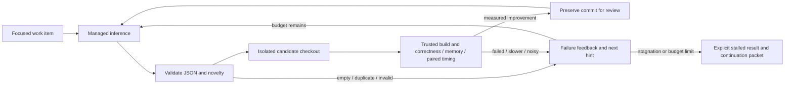

# Focused Qwen performance iteration

Tracking #68, parents #30/#29. The local Qwen 27B drives a bounded proposal → experiment → feedback
loop through a clean llama.cpp server. The loop never treats the model's claimed gain as evidence.
Its JSON subprocess boundary can later use Sub0Llm without changing work-item or evaluation policy.



## Contracts and behavior

`perf/optimization/iq1s-focused.json` is a runnable kernel-only work item. It pins the issue, one goal,
editable file allowlist, dynamically bounded source slice, invariants, trusted provider/evaluator
identities, timing criterion and attempt/stagnation/wall budgets. No model-supplied shell command runs.
Source text is included as data; it cannot authorize editing a test, changing a gate or expanding scope.

A proposal has `hypothesis`, `mechanism`, `edits` (path/exact-old/exact-new), and `no_change_reason`.
Each old text must match once; all hunks are validated before writing. Absolute/traversal/symlink
paths and out-of-scope files are rejected. The root checkout stays unchanged. Every attempt uses a
fresh detached worktree from the current best commit, and preserves its request, raw response, diff,
logs, evidence hashes and result. Measured improvements create local `optimization/...` review refs;
subsequent attempts build on that incumbent. They do not merge, push or promote themselves.

The trusted evaluator receives `{baseline}`, `{candidate}`, `{result}` and `{attempt}` paths.
It returns `optimization-evaluation-1`: exact candidate file hashes, baseline commit, explicit
qualification scope, correctness and memory verdicts, a performance verdict and evidence paths.
Only correctness=pass, memory=pass and performance=improved can advance the incumbent. Inconclusive
measurements never pass. Evaluator-produced files must exist inside the attempt directory and are
hashed. The evaluator must hold the shared performance lock across builds/checks/measurement.

The supplied `evaluate_kernel.py` compiles both native staged binaries and a generic candidate against the baseline's frozen
benchmark/independent double-dot fixtures. It checks fixtures and peak child RSS, then uses pinned
Sub0Math `sub0perf` timing, calibration, quiet-load, power, CPU pinning and lock helpers for five
interleaved baseline/candidate pairs. A gain must exceed both the predeclared 2% and three times
robust ratio noise; >2% robust CV or >5% calibration drift is inconclusive. The 256 MiB budget applies
to these kernel fixtures. This does not certify model RSS, full logits or corpus quality. Use a
model-scope evaluator with the existing #63 gates before production promotion.

Empty, duplicate, malformed, truncated, failed and non-improving attempts feed their concrete reason
into later requests. Both proposal fingerprints and resulting source hashes detect repeats. After
the configured stagnation window the runner rotates mechanism hints and continues; after the recovery
or run budget it records `stalled` or `budget_exhausted`, best commit, counts and a next hint. A stalled
CLI exits 3. It never declares global optimality. A mechanism is not permanently parked merely because
this bounded search failed; the project's three-pass policy still applies. An agent can inspect the
continuation packet, add assembly/profile evidence, narrow the item and start a new recorded run.

`--resume` requires the same item/provider/evaluator identities and a nonterminal run. Interrupted
attempts remain recorded, and resume starts the next attempt. A per-run OS lock excludes duplicate
writers. Candidate worktrees are deliberately retained for inspection; after reviewing/archiving their
diffs and local refs, remove them with `git worktree remove` and prune the associated experimental refs
when superseded. They contain tracked source, not copied model weights.

## Managed inference and host settings

`llama_provider.py` implements `optimization-request-1` → `optimization-inference-1` on stdin/stdout.
It verifies model and server/shared-library hashes, binds loopback, validates the model alias, counts
rendered prompt tokens before generation, requests schema-constrained JSON and records token rates,
usage, settings and server peak RSS. A clipped response is rejected even if its prefix parses as JSON.
The model server is shut down and reaped before the adapter returns; timeout/interrupt cleanup gives
the provider time to stop its separately grouped server. The parent holds the shared lock during
inference, releases it, then calls the evaluator. Inference and timing do not overlap.

The checked-in `llama-cpu.json` is the CrogBuntu1 profile for the existing model download. It uses native
CPU kernels/repacking, one slot, 4,096 context, batch 512 / microbatch 128, F16 KV and flash attention,
eight pinned physical decode cores and sixteen batch cores, and an 8 GiB inference RSS limit. Thinking
is disabled to bound the first structured-patch loop; sampling is configurable (initial temperature
0.6/top-p 0.95/top-k 20), and each attempt gets a recorded distinct seed. These are practical bounded
coding settings, not a claim that the model's reasoning quality was optimized.

[Real tuning evidence](QWEN_OPTIMIZER_TUNING.json), CrogBuntu1 2026-11-08: identical 748-token prompt
and fixed 22-token output, two rotated trials per profile. Median prompt/generation rates:

| Decode / batch threads | Prompt tokens/s | Generated tokens/s | Max RSS MiB |
|---|---:|---:|---:|
| 8 / 8 | 41.89 | 4.169 | 7031.49 |
| 8 / 16 | 60.37 | 4.225 | 7033.49 |
| 16 / 16 | 59.79 | 4.097 | 7033.59 |

The 8/16 profile minimizes prompt latency plus projected 512-token generation among those tested
(133.57 s versus 140.69 s and 137.52 s). This small descriptive tuning sweep selects a measured host
profile; it is not a universal optimum, a coding-quality comparison or a calibrated engine regression
verdict. Extend the profile grid and repeat on a new host/context. The model file is heavily quantized;
compile/oracle/measurement feedback remains the authority when its proposals are poor.

## Build and run on this machine

Use the clean pinned llama.cpp source (not the diagnostic float-activation reference). Existing source:
`/tmp/sub0-llama-stock`, revision `cf659f240b232e15700b1721bbb43c1d973c52e9`.
Verify that revision and clean source before building:

```sh
cmake -S /tmp/sub0-llama-stock -B out/build/llama-optimizer -G Ninja \
  -DCMAKE_BUILD_TYPE=Release -DCMAKE_C_COMPILER=clang -DCMAKE_CXX_COMPILER=clang++ \
  -DGGML_NATIVE=ON -DGGML_CPU_REPACK=ON -DGGML_CUDA=OFF -DGGML_VULKAN=OFF \
  -DLLAMA_BUILD_SERVER=ON -DLLAMA_BUILD_TOOLS=ON -DLLAMA_BUILD_APP=OFF \
  -DLLAMA_BUILD_TESTS=OFF -DLLAMA_BUILD_EXAMPLES=OFF -DLLAMA_OPENSSL=OFF \
  -DLLAMA_BUILD_UI=OFF -DLLAMA_USE_PREBUILT_UI=OFF -DCMAKE_BUILD_RPATH_USE_ORIGIN=ON
cmake --build out/build/llama-optimizer --target llama-server -j4
python3 scripts/optimization/iterate.py --item perf/optimization/iq1s-focused.json \
  --out out/optimization/iq1s-run-001
```

Run from the repository root with clean committed tracked files. Check the cross-agent CPU log first;
never overlap #63 capture or another performance run. `--proposals-only` records suggestions without
applying/executing them. Change budgets/context/scope by copying the work item to a new recorded JSON;
do not edit a running item's contract. All output paths must be new unless explicitly resuming.

`tune_llama.py --configs A.json B.json --request fixed-request.json --out NEW_DIR` performs the same
kind of fixed-output tuning. The request must use an enum-constrained response schema, so all profiles
see identical prompt/output tokens. Configurations can vary decode/batch cores, context and batching.
Raw replies/configs are preserved alongside the selected measured profile.

## Sub0Llm adapter milestone

Keep the same request/reply schema, prompt-budget checks, stop/truncation semantics, identity/timing/RSS
records and teardown guarantee. Replace `provider_command` with a specialized Sub0Llm executable or
adapter once it supports the work item's context and reliable structured output. The present mapped
128-position chat PoC cannot fit this work item; exceeding its capability must refuse rather than
silently omit source/feedback. Use a matched set of identical work items to compare inference latency,
proposal quality, accepted measured gains and cost per accepted candidate between engines.

The protocol and loop are engine-independent. Shared generic performance primitives remain upstream
Sub0Math; model prompts, work-item policy and candidate selection live here. Do not fork the vendored
rig for this workflow. Review useful generic lifecycle/tuning interfaces upstream after this proving
run, rather than adding model-specific policy to Sub0Math.
